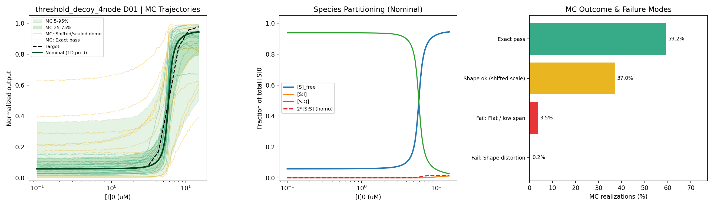

# CC-any-graph

Universal 1D + EQTK + 3D validation framework for *de novo* coiled-coil peptide design across arbitrary interaction graphs, Boolean logic gates, and analog concentration-response curves.

Extended from [coiled-coil-consensus](https://github.com/MyrtleLovesCCSDT/coiled-coil-consensus) (YES-gate pipeline) to support:
- **`mode: "graph"`**: arbitrary target interaction topologies, edge hierarchies, and off-target/homodimer suppression.
- **`mode: "truth_table"`**: all 10 non-trivial input-permutation equivalence classes of two-input Boolean logic (covering all 16 two-input functions up to `I1`/`I2` relabeling and trivial constants `0`/`1`), plus 3-input `OR` (`or3_5node`) and dual-output `ortho2_6node`.
- **`mode: "curve"`**: quantitative concentration-response curves (quadratic decay, prozone bandpass domes, and decoy-buffered sharp threshold switches).

---

## Summary of 1D + EQTK Results

Two Monte Carlo stages are reported separately for clarity:
1. **`Design MC` (`design_graph.py`, `n_mc = 200`, `sigma_pKd = 0.643`)**: post-SA ranking stage with `mc_conc_rel_std = 0.0` for all configs except `xor_4node` (`0.05`).
2. **`Sim MC` (`simulate_circuit.py`, `n_mc = 400`, `sigma_pKd = 0.643`, `conc_std = 0.015`)**: dense diagnostic sweep modeling nanoliter dispenser pipetting noise (`1.5%`). All diagnostic plots in `assets/` are generated at this stage.

Because the per-circuit pass threshold is `Delta >= 0.85 * min_delta` (where `min_delta` varies across configs from `0.35` to `0.65`), both the exact **`Thresh`** and the scale-comparable **`MC_Delta_p10`** (10th percentile of MC `Delta` from `design_graph.py`) are listed below.

### Logic Circuits (`mode: "truth_table"`)

| Circuit | Topology / Readout | Delta | Fold | Thresh (`0.85*min_Δ`) | `MC_Delta_p10` | Design MC (`n=200`) | Sim MC (`n=400, std=0.015`) | Worst Off / Homo pKd | Min Slip Margin |
| :--- | :--- | :---: | :---: | :---: | :---: | :---: | :---: | :---: | :---: |
| `yes_3node` | Buffer (`I-Q-S`, `free_frac(S)`) | 0.953 | 28.9x | 0.383 | 0.713 | 98.5% | 95.8% | 1.87 / 3.14 | 36.3 |
| `not_3node` | Inverter (`I-A-S`, `dimer_frac(A,S)`) | 0.982 | 156.4x | 0.383 | 0.887 | 100.0% | 99.2% | 2.84 / 3.73 | 44.2 |
| `or_4node` | OR (`I1,I2-Q-S`, `free_frac(S)`) | 0.944 | 21.9x | 0.383 | 0.738 | 98.0% | 94.2% | 3.12 / 3.52 | 30.8 |
| `nor_4node` | Compact NOR (`dimer_frac(Q,S)`) | 0.981 | 192.3x | 0.553 | 0.874 | 96.0% | 93.8% | 2.29 / 3.49 | 21.2 |
| `nor_5node` | Fig. S4 NOR (`free_frac(S)`, 5-mer) | 0.876 | 14.0x | 0.425 | 0.462 | 78.5% | 72.8% | 3.97 / 3.95 | 21.6 |
| `and_5node` | Fig. S4 AND (`free_frac(S)`, 4-mer) | 0.929 | 34.0x | 0.553 | 0.524 | 69.0% | 65.5% | 4.15 / 3.96 | 16.1 |
| `and_6node` | Split-reporter AND (`SA:SB`, 4-mer) | 0.540 | 14.9x | 0.425 | 0.137 | 39.0% | 37.2% | 4.53 / 4.58 | 23.3 |
| `nand_6node` | Fig. S4 NAND (`free_frac(S)`, 5-mer) | 0.780 | 6.9x | 0.425 | 0.238 | 42.5% | 43.5% | 4.85 / 4.32 | -26.4* |
| `imply_5node` | Fig. S4 `NOT I1 OR I2` (`free_frac(S)`) | 0.827 | 13.5x | 0.425 | 0.289 | 70.5% | 64.2% | 4.34 / 3.78 | 27.9 |
| `nimply_4node` | Compact `I1 AND NOT I2` (`free_frac(S)`) | 0.942 | 34.8x | 0.553 | 0.648 | 83.5% | 82.2% | 3.99 / 4.24 | 27.1 |
| `nimply_6node` | Fig. S4 `I1 AND NOT I2` (`free_frac(S)`) | 0.862 | 11.5x | 0.425 | 0.348 | 61.5% | 57.2% | 4.49 / 3.77 | 24.5 |
| `xor_4node` | Competitive sink (`A:B >> A,B:Q > Q:S`) | 0.713 | 5.0x | 0.298 | 0.165 | 66.0% (`std=0.05`) | 61.5% | 3.75 / 4.34 | 21.6 |
| `xnor_4node` | Dimer readout of XOR (`dimer_frac(Q,S)`) | 0.698 | 11.8x | 0.425 | 0.162 | 43.5% | 45.8% | 4.34 / 4.47 | 5.8 |
| `xnor_5node` | Mediator XNOR (`A:B > A,B:M > M:Q > Q:S`) | 0.614 | 4.1x | 0.383 | 0.118 | 30.0% | 24.2% | 4.28 / 3.97 | -42.8* |
| `or3_5node` | 3-input OR (8 states, 4-mer) | 0.950 | 31.5x | 0.510 | 0.685 | 91.0% | 84.5% | 2.50 / 3.54 | 28.6 |
| `ortho2_6node` | Dual orthogonal YES outputs | 0.857 | 12.9x | 0.383 | 0.462 | 87.0% (joint) | 94.2% / 81.2% (per-obs) | 4.04 / 4.13 | 43.9 |

*\*Note on slippage margins: `min_slip_margin` is computed over target edges with `require_par=true` and `require_shift0=true`. In `nand_6node` D01, `-26.4` originates from the 5-mer/4-mer `M1:Q1` edge (`shift=7`), not from `Q1:S` (`require_shift0=false`, `shift=0`, `slip=32.3`). Similarly, in `xnor_5node` D01, `-42.8` originates from `M:Q` (`shift=7`).*

### Analog Curves (`mode: "curve"`)

Exact quantitative curve matching (`Exact Pass`: `RMSE`/`Span` within strict thresholds without rescaling) is reported separately from qualitative **shape preservation** (`Exact + Shifted/Scaled`, where the target curve shape survives with a shifted peak/midpoint or scale under `sigma_pKd = 0.643`).

| Design (Source) | Objective | R2 | RMSE | Span | Design MC Exact (`n=200, std=0`) | Sim MC Exact (`n=400, std=0.015`) | Sim Shape Preserved (`Exact + Shifted/Scaled`) | Worst Off / Homo pKd | Min Slip |
| :--- | :--- | :---: | :---: | :---: | :---: | :---: | :---: | :---: | :---: |
| `analog_bandpass` (preset `bandpass`) | Prozone bandpass dome | 0.890 | 0.077 | 0.661 | 17.5% | 13.0% | 80.2% (13.0% + 67.2%) | - / 4.02 | 35.3 |
| `dome_3node` (`dome_3node.json`, D01) | Prozone bandpass dome | 0.890 | 0.070 | 0.745 | 24.0% | 15.8% | 91.6% (15.8% + 75.8%) | - / 4.46 | 32.4 |
| `analog_neg_x2` (preset `neg_x2`) | `0.95*(1-(X/8.5)^2)` | 0.972 | 0.047 | 0.700 | 22.0% | 17.5% | 76.7% (17.5% + 59.2%) | 4.30 / 4.54 | 24.8 |
| `threshold_decoy_4node` (`threshold_decoy_4node.json`) | Decoy-buffered sharp switch | 0.997 | 0.019 | 0.885 | 65.5% | 59.2% | 96.2% (59.2% + 37.0%) | 4.34 / 4.35 | 27.6 |

*Note on `dome_3node`: D01 (`worst_homo = 4.46`, `Exact = 15.8%`, `Dome survival = 91.6%`) is shown in `assets/dome_3node.png`; D08 (`R2 = 0.883`, `RMSE = 0.072`, `worst_homo = 2.64`, `Exact = 14.5%`, `Dome survival = 89.3%`) is the preferred low-homodimer candidate.*

### Arbitrary Interaction Graphs (`mode: "graph"`)

| Design (Config File) | Topology | `graph_loss` | Worst Off / Homo pKd | Min Slip Margin |
| :--- | :--- | :---: | :---: | :---: |
| `custom_graph_xor_topo` (`configs/circuits/custom_graph_test.json`) | Triangle + tail (`A:B > A,B:Q > Q:S`) | -0.957 | 3.45 / 3.97 | 13.9 |
| `cycle_c4` (`configs/circuits/cycle_c4.json`) | 4-cycle (`A-B-C-D-A`, no diagonals) | -1.350 | 2.72 / 2.75 | 32.7 |
| `bipartite_k23` (`configs/circuits/bipartite_k23.json`) | `K2,3` bipartite graph | -2.025 | 2.44 / 2.65 | 5.0 |
| `cascade_5node` (`configs/circuits/cascade_5node.json`) | Weighted chain (`A:B > B:C > C:D > D:E`) | -1.927 | 3.48 / 3.81 | 27.6 |
| `barbell_6node` (`configs/circuits/barbell_6node.json`) | Two triangles + bridge (`C1:C2`) | 0.478 | 4.41 / 4.46 | 20.9 |

---

## Diagnostic Examples (`simulate_circuit.py`, `n_mc = 400`, `conc_std = 0.015`)

| `and_5node` (Sim MC Pass: 65.5%) | `xor_4node` (Sim MC Pass: 61.5%) |
| :---: | :---: |
|  |  |

| `dome_3node` D01 (Exact: 15.8%, Dome: 91.6%) | `threshold_decoy_4node` (Exact: 59.2%, Shape: 96.2%) |
| :---: | :---: |
|  |  |

---

## Designed Sequences & Data

All top-10 designed candidates per circuit (`*_full.json`, `*_designs.csv`) are committed under `results/graph_designs/<name>/`, alongside a consolidated top-3 summary table in [`designs_top3_summary.csv`](designs_top3_summary.csv).

---

## Quickstart

### 1. Design from preset or custom JSON
```bash
# Built-in preset (yes, not, or, and, xor, ortho2, neg_x2, bandpass)
python3 scripts/design_graph.py --preset xor --allow-5mer --tune-conc --restarts 32 --steps 2500

# Custom arbitrary graph / logic / curve config
python3 scripts/design_graph.py --config configs/circuits/and_5node.json --out-dir results/graph_designs --tune-conc --restarts 32 --steps 2500
```

### 2. Dense sweep & Monte Carlo failure diagnostics
```bash
python3 scripts/simulate_circuit.py \
  --full-json results/graph_designs/and_5node/and_5node_full.json \
  --conc-std 0.015 --n-mc 400
```

### 3. 3D validation pipeline (Boltz-2 + PyRosetta)
```bash
# Export dimer, off-target, homodimer, and 3-node heterotrimer/homotrimer jobs
python3 scripts/export_3d_jobs_graph.py \
  --full-json results/graph_designs/*/*_full.json \
  --top-n 2 --trimer-mode hubs --max-offtargets -1 --max-trimers 12

# Run Boltz-2 on cluster over results/3d_inputs/boltz_yaml/*.yaml -> results/boltz_out, then:
python3 scripts/analyze_boltz.py --boltz-dir results/boltz_out --manifest results/3d_inputs/manifest.csv --out results/boltz_3d_summary.csv
python3 scripts/score_rosetta.py --boltz-summary results/boltz_3d_summary.csv --manifest results/3d_inputs/manifest.csv --out-dir results/rosetta --out results/rosetta_3d_summary.csv --skip-existing
python3 scripts/scorecard_3d_graph.py --full-json results/graph_designs/and_5node/and_5node_full.json --manifest results/3d_inputs/manifest.csv --rosetta-summary results/rosetta_3d_summary.csv --out-dir results/3d_scorecards
```

---

## Repository Structure

```text
CC-any-graph/
├── configs/
│   ├── consensus_calibration.json   # 4-model Ridge fit (loo_r=0.917, loo_rmse=0.643)
│   └── circuits/                    # Arbitrary graph, logic gate & analog curve JSON specs
├── src/
│   ├── anchors.py                   # Experimental anchor datasets
│   ├── consensus.py                 # ConsensusModel + shift/orientation scan + slippage_margin
│   ├── sequence_space.py            # PeptideSpec, mixed E/K barcodes, 3/35/4/5-mer spaces
│   ├── circuit_eq.py                # Generalized EQTK equilibrium + observables + MC
│   ├── graph_design.py              # Multi-start SA + Nelder-Mead concentration tuning
│   └── structure_3d.py              # Boltz-2 CIF structural metrics
├── scripts/
│   ├── calibrate.py                 # Refits consensus_calibration.json
│   ├── design_graph.py              # Main CLI (presets + --config)
│   ├── simulate_circuit.py          # Dense concentration sweep & MC failure modes
│   ├── make_extra_configs.py        # Reproduces extra gate/graph JSON configs
│   ├── plot_graph_mc.py             # 3-panel MC robustness plots for mode='graph'
│   ├── export_3d_jobs_graph.py      # Multi-circuit Boltz-2/ColabFold job exporter
│   ├── analyze_boltz.py             # Parses Boltz-2 outputs
│   ├── score_rosetta.py             # PyRosetta FastRelax + InterfaceAnalyzerMover
│   └── scorecard_3d_graph.py        # 3D-EQTK consistency & Complete_3D scorecard
├── results/graph_designs/           # Committed *_full.json and *.csv designs per circuit
├── designs_top3_summary.csv         # Consolidated top-3 sequences & metrics across all 25 designs
└── assets/                          # Diagnostic plots
```

## Calibration Scope & Planned 3D Checks
- **1D model domain**: calibrated on 3–4 heptad canonical parallel dimers (`BN4:BN4` Kd = 48 uM, pKd = 4.32 is the sole homodimer anchor).
- **Pre-synthesis checks**: 5-mers, homodimers with pKd > 4.32 (e.g., prefer `dome_3node D08` over `D01`), mixed E/K antiparallel flips, register shifts (`M1:Q1` in `nand_6node`), and trimer traps (`A:B:Q`, `X:Q:S`, `uuu`) require Boltz-2 + PyRosetta filtering via `scorecard_3d_graph.py` prior to peptide synthesis.
