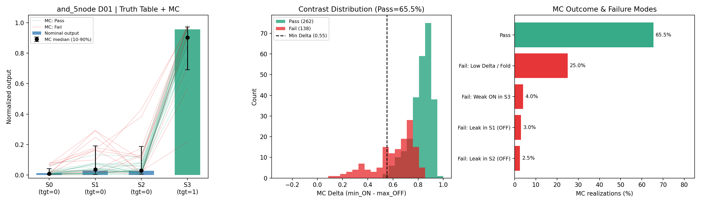
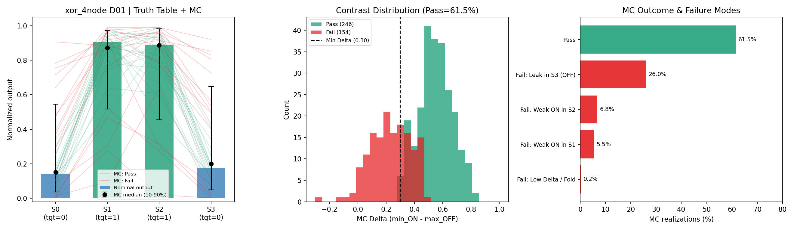
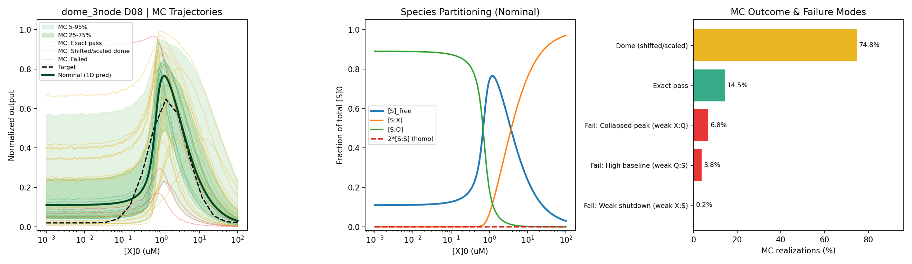

# CC-any-graph

Universal 1D + EQTK + 3D validation framework for *de novo* coiled-coil peptide design across arbitrary interaction graphs, Boolean logic gates, and analog concentration-response curves.

Extended from [coiled-coil-consensus](https://github.com/MyrtleLovesCCSDT/coiled-coil-consensus) (YES-gate pipeline) to support:
- **`mode: "graph"`**: arbitrary target interaction topologies, edge hierarchies, and off-target/homodimer suppression.
- **`mode: "truth_table"`**: all 16 two-input Boolean logic classes (Nikitin molecular commutation topologies + compact coiled-coil-native topologies), 3-input `OR`, and multi-output orthogonal circuits (`ortho2`).
- **`mode: "curve"`**: quantitative concentration-response curves (quadratic decay, bandpass prozone dome, and decoy-buffered sharp threshold switches).

---

## Summary of 1D + EQTK Results

All designs below were generated with multi-start Simulated Annealing + Nelder-Mead scaffold concentration tuning (`--tune-conc`) and evaluated via EQTK Monte Carlo robustness (`sigma_pKd = 0.643`, `conc_std = 0.015–0.05`).

### Logic Circuits (`mode: "truth_table"`)

| Circuit | Topology / Readout | Delta | Fold | MC Pass Rate | Worst Off / Homo pKd | Min Slip Margin |
| :--- | :--- | :---: | :---: | :---: | :---: | :---: |
| `yes_3node` | Buffer (`I-Q-S`, `free_frac(S)`) | 0.953 | 28.9x | 98.5% | 1.87 / 3.14 | 36.3 |
| `not_3node` | Inverter (`I-A-S`, `dimer_frac(A,S)`) | 0.982 | 156.4x | 100.0% | 2.84 / 3.73 | 44.2 |
| `or_4node` | OR (`I1,I2-Q-S`, `free_frac(S)`) | 0.944 | 21.9x | 98.0% | 3.12 / 3.52 | 30.8 |
| `nor_4node` | Compact NOR (`dimer_frac(Q,S)`) | 0.981 | 192.3x | 96.0% | 2.29 / 3.49 | 21.2 |
| `nor_5node` | Fig. S4 NOR (`free_frac(S)`, 5-mer) | 0.876 | 14.0x | 78.5% | 3.97 / 3.95 | 21.6 |
| `and_5node` | Fig. S4 AND (`free_frac(S)`, 4-mer) | 0.929 | 34.0x | 69.0% | 4.15 / 3.96 | 16.1 |
| `and_6node` | Split-reporter AND (`SA:SB`, 4-mer) | 0.540 | 14.9x | 39.0% | 4.53 / 4.58 | 23.3 |
| `nand_6node` | Fig. S4 NAND (`free_frac(S)`, 5-mer) | 0.780 | 6.9x | 42.5% | 4.85 / 4.32 | -26.4* |
| `imply_5node` | Fig. S4 `NOT I1 OR I2` (`free_frac(S)`) | 0.827 | 13.5x | 70.5% | 4.34 / 3.78 | 27.9 |
| `nimply_4node` | Compact `I1 AND NOT I2` (`free_frac(S)`) | 0.942 | 34.8x | 83.5% | 3.99 / 4.24 | 27.1 |
| `nimply_6node` | Fig. S4 `I1 AND NOT I2` (`free_frac(S)`) | 0.862 | 11.5x | 61.5% | 4.49 / 3.77 | 24.5 |
| `xor_4node` | Competitive sink (`A:B >> A,B:Q > Q:S`) | 0.713 | 5.0x | 66.0% | 3.75 / 4.34 | 21.6 |
| `xnor_4node` | Dimer readout of XOR (`dimer_frac(Q,S)`) | 0.698 | 11.8x | 43.5% | 4.34 / 4.47 | 5.8 |
| `or3_5node` | 3-input OR (8 states, 4-mer) | 0.950 | 31.5x | 91.0% | 2.50 / 3.54 | 28.6 |
| `ortho2_6node` | Dual orthogonal YES outputs (joint MC) | 0.857 | 12.9x | 87.0% | 4.04 / 4.13 | 43.9 |

*Note: `nand_6node` D01 carries a negative `min_slip_margin` when `Q1:S` allows register shift/3-mer; setting `require_shift0: true` on `Q1:S` removes this penalty.*

### Arbitrary Graphs (`mode: "graph"`) & Analog Curves (`mode: "curve"`)

| Design | Mode / Objective | Key Metrics |
| :--- | :--- | :--- |
| `custom_graph_xor_topo` | `graph` (triangle + tail) | `graph_loss=-0.957`, off <= 3.45, homo <= 3.97 |
| `cycle_c4` | `graph` (4-cycle, no diagonals) | `graph_loss=-1.350`, off=2.72, homo=2.75, slip=32.7 |
| `bipartite_k23` | `graph` (K2,3 bipartite) | `graph_loss=-2.025`, off=2.44, homo=2.65, slip=5.0 |
| `cascade_5node` | `graph` (weighted 5-node chain) | `graph_loss=-1.927`, off=3.48, homo=3.81, slip=27.6 |
| `barbell_6node` | `graph` (two triangles + bridge) | `graph_loss=0.478`, off=4.41, homo=4.46, slip=20.9 |
| `analog_neg_x2` | `curve` (`0.95*(1-(X/8.5)^2)`) | `R2=0.972`, `RMSE=0.047`, `MC=22.0%` |
| `dome_3node` | `curve` (prozone bandpass dome) | D01 `R2=0.890`, 91.6% survival; D08 `R2=0.883`, homo=2.64, 89.3% survival |
| `threshold_decoy_4node` | `curve` (decoy-buffered sharp switch) | `R2=0.997`, `RMSE=0.019`, `MC=65.5%` (`MC_R2_med=0.930`) |

---

## Diagnostic Examples

| `and_5node` (Fig. S4 AND) | `xor_4node` (4-node XOR) |
| :---: | :---: |
|  |  |

| `dome_3node` (Bandpass Prozone) | `threshold_decoy_4node` (Delayed Switch) |
| :---: | :---: |
|  |  |

---

## Quickstart

### 1. Design from preset or custom JSON
```bash
# Built-in preset (yes, not, or, and, xor, ortho2, neg_x2, bandpass)
python3 scripts/design_graph.py --preset xor --allow-5mer --tune-conc --restarts 32 --steps 2500

# Custom arbitrary graph / logic / curve config
python3 scripts/design_graph.py --config configs/circuits/and_5node.json --out-dir results/graph_designs --tune-conc --restarts 32 --steps 2500
```

### 2. Dense sweep & Monte Carlo failure diagnostics
```bash
python3 scripts/simulate_circuit.py \
  --full-json results/graph_designs/and_5node/and_5node_full.json \
  --conc-std 0.015 --n-mc 400
```

### 3. 3D validation pipeline (Boltz-2 + PyRosetta)
```bash
# Export dimer, off-target, homodimer, and 3-node heterotrimer/homotrimer jobs
python3 scripts/export_3d_jobs_graph.py \
  --full-json results/graph_designs/*/*_full.json \
  --top-n 2 --trimer-mode hubs --max-offtargets -1 --max-trimers 12

# Run Boltz-2 on cluster over results/3d_inputs/boltz_yaml/*.yaml -> results/boltz_out, then:
python3 scripts/analyze_boltz.py --boltz-dir results/boltz_out --manifest results/3d_inputs/manifest.csv --out results/boltz_3d_summary.csv
python3 scripts/score_rosetta.py --boltz-summary results/boltz_3d_summary.csv --manifest results/3d_inputs/manifest.csv --out-dir results/rosetta --out results/rosetta_3d_summary.csv --skip-existing
python3 scripts/scorecard_3d_graph.py --full-json results/graph_designs/and_5node/and_5node_full.json --manifest results/3d_inputs/manifest.csv --rosetta-summary results/rosetta_3d_summary.csv --out-dir results/3d_scorecards
```

---

## Repository Structure

```text
CC-any-graph/
├── configs/
│   ├── consensus_calibration.json   # 4-model Ridge fit (loo_r=0.917, loo_rmse=0.643)
│   └── circuits/                    # Arbitrary graph, logic gate & analog curve JSON specs
├── src/
│   ├── anchors.py                   # Experimental anchor datasets
│   ├── consensus.py                 # ConsensusModel + shift/orientation scan + slippage_margin
│   ├── sequence_space.py            # PeptideSpec, mixed E/K barcodes, 3/35/4/5-mer spaces
│   ├── circuit_eq.py                # Generalized EQTK equilibrium + observables + MC
│   ├── graph_design.py              # Multi-start SA + Nelder-Mead concentration tuning
│   └── structure_3d.py              # Boltz-2 CIF structural metrics
├── scripts/
│   ├── calibrate.py                 # Refits consensus_calibration.json
│   ├── design_graph.py              # Main CLI (presets + --config)
│   ├── simulate_circuit.py          # Dense concentration sweep & MC failure modes
│   ├── make_extra_configs.py        # Reproduces extra gate/graph JSON configs
│   ├── export_3d_jobs_graph.py      # Multi-circuit Boltz-2/ColabFold job exporter
│   ├── analyze_boltz.py             # Parses Boltz-2 outputs
│   ├── score_rosetta.py             # PyRosetta FastRelax + InterfaceAnalyzerMover
│   └── scorecard_3d_graph.py        # 3D-EQTK consistency & Complete_3D scorecard
└── assets/                          # Diagnostic plots
```

## Calibration Scope & Planned 3D Checks
- **1D model domain**: calibrated on 3–4 heptad canonical parallel dimers (`BN4:BN4` Kd = 48 uM, pKd = 4.32 is the sole homodimer anchor).
- **Pre-synthesis checks**: 5-mers, homodimers with pKd > 4.32 (e.g., prefer `dome_3node D08` over `D01`), mixed E/K antiparallel flips, and trimer traps (`A:B:Q`, `X:Q:S`, `uuu`) require Boltz-2 + PyRosetta filtering via `scorecard_3d_graph.py` prior to peptide synthesis.
